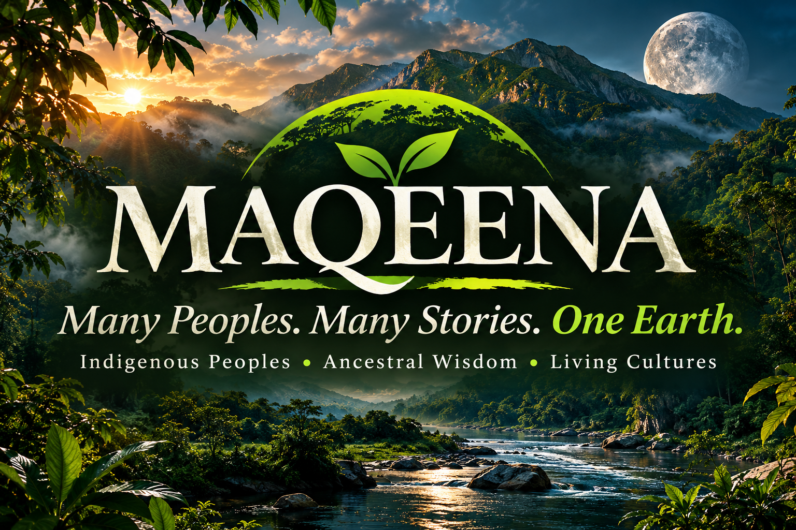

# 🌎 Maqeena

**Many Peoples. Many Stories. One Earth.**

What if understanding our roots could help us reconnect with Mother Earth? 🌱

Maqeena is a **free, open-source educational app** dedicated to Indigenous peoples, histories, living cultures, ancestral wisdom and sovereignty.



[](https://michaelsboost.github.io/maqeena/)
[](https://github.com/michaelsboost/maqeena)
[](LICENSE.md)
[](https://github.com/michaelsboost/maqeena/stargazers)
[](https://github.com/michaelsboost/maqeena/issues)

**[🌎 Start exploring](https://michaelsboost.github.io/maqeena/) · [💻 View source](https://github.com/michaelsboost/maqeena) · [💚 Donate](https://michaelsboost.com/donate)**

---

## ✨ What can you do?

- 📚 **Learn** through interactive lessons, games and glossary flashcards.
- 🗺️ **Explore** Indigenous peoples, territories and historical timelines.
- 🌙 **Discover** creation stories, including Mother Earth, the Sun and Moon, and Turtle Island.
- 🌿 **Connect** with ancestral knowledge and traditional ecological perspectives.
- 🎬 **Watch and read** through films, books and educational resources.
- ✊ **Understand** Indigenous rights, sovereignty and advocacy dates.
- 📈 **Track** your learning progress and search educational content.

## 🌱 The story behind Maqeena

Inspired by the Lakota words **Makȟá** (Earth) and **Iná** (mother), Maqeena is a coined name evoking Mother Earth. Its inspiration also comes from a Lakota creation account shared by Albert White Hat Sr., in which the Moon restores balance.

> Humanity’s fundamental crisis is disconnection — from ourselves, from each other, from our animal brothers and sisters, and from Mother Earth.

## 🤲 Cultural respect

Maqeena aims to support learning, not speak for Indigenous peoples. Creation stories are attributed retellings with source links. Respect distinct traditions, sovereignty and community permissions. Linguistic and community review and trademark clearance remain pending.

## 🛠️ Run or build it yourself

With Node.js and npm installed, run from the project directory:

```bash
npm install
npm run build
npm run serve
```

Open `http://localhost:8081` in your browser.

### 📱 Termux (Android)

```bash
pkg install nodejs rsync coreutils
bash build-termux.sh
```

## 🤝 Contribute

Feedback, corrections and contributions are welcome. Please include reliable sources and respect cultural permissions.

**[🐛 Report an issue](https://github.com/michaelsboost/maqeena/issues) · [⭐ Star the repo](https://github.com/michaelsboost/maqeena/stargazers)**

## 📄 License

Software: [MIT License](LICENSE.md). Third-party cultural content and media retain their respective rights.

## 👋 Creator

Created by **Michael Schwartz** · [michaelsboost.com](https://michaelsboost.com)

---

**🌎 Maqeena — Many Peoples. Many Stories. One Earth.**
